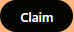
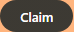
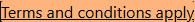
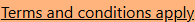
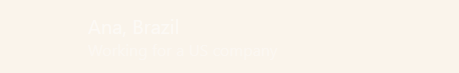

# cambly Design System

You are building UI for **cambly**. Dark-themed, neutral palette, sans-serif typography (Garnett), compact density on a 4px grid.

## Visual Reference

**IMPORTANT**: Study ALL screenshots below before writing any UI. Match colors, typography, spacing, layout, and motion exactly as shown.

### Homepage


### Scroll Journey (Cinematic Visual States)

> These screenshots capture the website at different scroll depths. The design changes dramatically as you scroll — each frame shows a different cinematic state. Replicate these exact visual transitions.

#### 0% — Hero / Above the fold


#### 17% — Mid-page at 17% scroll


#### 33% — Mid-page at 33% scroll


#### 50% — Mid-page at 50% scroll


#### 67% — Mid-page at 67% scroll


#### 83% — Mid-page at 83% scroll


#### 100% — Footer / End of page


### Video Backgrounds (First Frames)


> Read `references/DESIGN.md` for full token details. Read `references/ANIMATIONS.md` for motion specs. Read `references/LAYOUT.md` for layout structure. Read `references/COMPONENTS.md` for component patterns.

## Ultra Reference Files

This package includes extended documentation. **Read these files before implementing:**

| File | Contents |
|------|----------|
| `references/DESIGN.md` | Full design system tokens, colors, typography, spacing |
| `references/VISUAL_GUIDE.md` | **START HERE** — Master visual guide with all screenshots embedded |
| `references/ANIMATIONS.md` | CSS keyframes, scroll triggers, motion library stack, video specs |
| `references/LAYOUT.md` | Flex/grid containers, page structure, spacing relationships |
| `references/COMPONENTS.md` | DOM component patterns, HTML structure, class fingerprints |
| `references/INTERACTIONS.md` | Hover/focus states with before/after style diffs |
| `screens/scroll/` | 7 scroll journey screenshots showing cinematic states |

## Design Philosophy

- **Layered depth** — use shadow tokens to create a sense of physical layering. Each elevation level has a specific shadow.
- **Gradient accents** — gradients are used thoughtfully for emphasis, not decoration.
- **Type pairing** — Garnett for body/UI text, GT Super for headings/display. Never introduce a third typeface.
- **compact density** — 4px base grid. Every dimension is a multiple of 4.
- **neutral palette** — the color temperature runs neutral, matching the sans-serif typography.
- **Subtle motion** — transitions smooth state changes. Keep durations under 300ms, use ease-out curves.

## Color System

### Core Palette

| Role | Token | Hex | Use |
|------|-------|-----|-----|
| Background | `--background` | `#000000` | Page/app background |
| Surface | `--surface` | `#191919` | Cards, panels, modals |
| Text Primary | `--text-primary` | `#ffffff` | Headings, body text |
| Text Muted | `--text-muted` | `#5e5952` | Captions, placeholders |
| Border | `--border` | `#363432` | Dividers, card borders |

### Status Colors

| Status | Hex | Use |
|--------|-----|-----|
| Success | `#84ce64` | Confirmations, positive trends |
| Warning | `#ffe733` | Caution states, pending items |
| Danger | `#ff8071` | Errors, destructive actions |

### Extended Palette

- `#0000ee`
- `#838383`
- **color-base-gray-200:** `#e4dbd3`
- `#eff6fa` — Light surface or highlight color
- `#236482`
- **color-base-gray-10:** `#beb4ab`
- **color-base-gray-100:** `#faf4eb` — Light surface or highlight color
- `#27455c`

### CSS Variable Tokens

```css
--color-base-destructive-100: #ffdeda;
--color-base-destructive-200: #ff8071;
--color-base-destructive-300: #ff8071;
--color-base-destructive-700: #c93f32;
--color-base-destructive-800: #6d0002;
--color-base-destructive-900: #6d0002;
--color-base-primary-100: #faf4eb;
--color-base-primary-200: #e4dbd3;
--color-base-primary-300: #beb4ab;
--color-base-primary-700: #5e5952;
--color-base-primary-800: #363432;
--color-base-primary-900: #262625;
--color-cambio-destructive-100: #ffdeda;
--color-cambio-destructive-300: #ff8071;
--color-cambio-destructive-370: rgba(255,128,113,0.7);
--color-cambio-destructive-700: #c93f32;
--color-cambio-destructive-770: rgba(201,63,50,0.7);
--color-cambio-destructive-900: #6d0002;
--color-base-destructive-100: #ffdeda;
--color-base-destructive-200: #ff8071;
```

## Typography

### Font Stack

- **Garnett** — Heading 1, Heading 2, Heading 3
- **GT Super** — Body, Caption

### Font Sources

```css
@font-face {
  font-family: "GT Super";
  src: url("fonts/GTSuper-700.woff2") format("woff2");
  font-weight: 700;
}
@font-face {
  font-family: "Garnett";
  src: url("fonts/Garnett-Regular.woff") format("woff");
  font-weight: 400;
}
```

### Type Scale

| Role | Family | Size | Weight |
|------|--------|------|--------|
| Heading 1 | Garnett | 119px | 700 |
| Heading 2 | Garnett | 83px | 700 |
| Heading 3 | Garnett | 76px | 700 |
| Body | GT Super | 16px | 400 |
| Caption | GT Super | 14px | 400 |

### Typography Rules

- Body/UI: **Garnett**, Headings: **GT Super** — these are the only display fonts
- Max 3-4 font sizes per screen
- Headings: weight 600-700, body: weight 400
- Use color and opacity for text hierarchy, not additional font sizes
- Line height: 1.5 for body, 1.2 for headings

## Spacing & Layout

### Base Grid: 4px

Every dimension (margin, padding, gap, width, height) must be a multiple of **4px**.

### Spacing Scale

`2, 4, 6, 8, 10, 12, 16, 20, 24, 28, 30, 32` px

### Spacing as Meaning

| Spacing | Use |
|---------|-----|
| 4-8px | Tight: related items (icon + label, avatar + name) |
| 12-16px | Medium: between groups within a section |
| 24-32px | Wide: between distinct sections |
| 48px+ | Vast: major page section breaks |

### Border Radius

Scale: `1px, 2px, 2.5px, 3px, 4px, 6px, 8px, 12px, 16px, 17px, 20px, 21.27px, 24px, 34px, 50px, 52px, 100px, 100%, 999px`
Default: `17px`

### Container

Max-width: `960px`, centered with auto margins.

### Breakpoints

| Name | Value |
|------|-------|
| xs | 480px |
| sm | 481px |
| lg | 960px |
| xl | 1120px |

Mobile-first: design for small screens, layer on responsive overrides.

## Component Patterns

### Card

```css
.card {
  background: #191919;
  border: 1px solid #363432;
  border-radius: 17px;
  padding: 16px;
  box-shadow: var(--elevation-400);
}
```

```html
<div class="card">
  <h3>Card Title</h3>
  <p>Card content goes here.</p>
</div>
```

### Button

```css
/* Primary */
.btn-primary {
  background: #444444;
  color: #ffffff;
  border-radius: 17px;
  padding: 8px 16px;
  font-weight: 500;
  transition: opacity 150ms ease;
}
.btn-primary:hover { opacity: 0.9; }

/* Ghost */
.btn-ghost {
  background: transparent;
  border: 1px solid #363432;
  color: #ffffff;
  border-radius: 17px;
  padding: 8px 16px;
}
```

```html
<button class="btn-primary">Get Started</button>
<button class="btn-ghost">Learn More</button>
```

### Input

```css
.input {
  background: #000000;
  border: 1px solid #363432;
  border-radius: 17px;
  padding: 8px 12px;
  color: #ffffff;
  font-size: 14px;
}
.input:focus { border-color: var(--accent); outline: none; }
```

```html
<input class="input" type="text" placeholder="Search..." />
```

### Badge / Chip

```css
.badge {
  display: inline-flex;
  align-items: center;
  padding: 4px 8px;
  border-radius: 9999px;
  font-size: 12px;
  font-weight: 500;
  background: #191919;
  color: #5e5952;
}
```

```html
<span class="badge">New</span>
<span class="badge">Beta</span>
```

### Modal / Dialog

```css
.modal-backdrop { background: rgba(0, 0, 0, 0.6); }
.modal {
  background: #191919;
  border: 1px solid #363432;
  border-radius: 999px;
  padding: 24px;
  max-width: 480px;
  width: 90vw;
  box-shadow: 0 4px 8px 0 rgba(0,0,0,.2),0 6px 20px 0 rgba(0,0,0,.19);
}
```

```html
<div class="modal-backdrop">
  <div class="modal">
    <h2>Dialog Title</h2>
    <p>Dialog content.</p>
    <button class="btn-primary">Confirm</button>
    <button class="btn-ghost">Cancel</button>
  </div>
</div>
```

### Table

```css
.table { width: 100%; border-collapse: collapse; }
.table th {
  text-align: left;
  padding: 8px 12px;
  font-weight: 500;
  font-size: 12px;
  color: #5e5952;
  text-transform: uppercase;
  letter-spacing: 0.05em;
  border-bottom: 1px solid #363432;
}
.table td {
  padding: 12px;
  border-bottom: 1px solid #363432;
}
```

```html
<table class="table">
  <thead><tr><th>Name</th><th>Status</th><th>Date</th></tr></thead>
  <tbody>
    <tr><td>Item One</td><td>Active</td><td>Jan 1</td></tr>
    <tr><td>Item Two</td><td>Pending</td><td>Jan 2</td></tr>
  </tbody>
</table>
```

### Navigation

```css
.nav {
  display: flex;
  align-items: center;
  gap: 8px;
  padding: 12px 16px;
  border-bottom: 1px solid #363432;
}
.nav-link {
  color: #5e5952;
  padding: 8px 12px;
  border-radius: 17px;
  transition: color 150ms;
}
.nav-link:hover { color: #ffffff; }
```

```html
<nav class="nav">
  <a href="/" class="nav-link active">Home</a>
  <a href="/about" class="nav-link">About</a>
  <a href="/pricing" class="nav-link">Pricing</a>
  <button class="btn-primary" style="margin-left: auto">Get Started</button>
</nav>
```

### Extracted Components

These components were found in the codebase:

**Button** (`html`)

**Navigation** (`html`)

## Page Structure

The following page sections were detected:

- **Navigation** — Top navigation bar (12 items)
- **Hero** — Hero section (detected from heading structure)
- **Footer** — Page footer with links and info (25 items)
- **Faq** — FAQ/accordion section

When building pages, follow this section order and structure.

## Animation & Motion

This project uses **subtle motion**. Transitions smooth state changes without calling attention.

### CSS Animations

- `_syntaxButtonLoadingRotate_v2jgj_1`
- `AudioInputIconButton_camblyPulse__F3H_0`
- `LoadingSpinner_camblySpinAnimation__534KI`
- `FilterChip_camblyFilterChipLoading__4mouG`

### Motion Tokens

- **Duration scale:** `0ms`, `.2s`, `200ms`, `400ms`, `500ms`
- **Easing functions:** `linear`, `cubic-bezier(.65,.04,.35,1)`, `cubic-bezier(.19,1,.22,1)`
- **Animated properties:** `grid-template-rows`, `visibility`

### Motion Guidelines

- **Duration:** Use values from the duration scale above. Short (0ms) for micro-interactions, long (500ms) for page transitions
- **Easing:** Use `linear` as the default easing curve
- **Direction:** Elements enter from bottom/right, exit to top/left
- **Reduced motion:** Always respect `prefers-reduced-motion` — disable animations when set

## Depth & Elevation

### Shadow Tokens

- Subtle: `0 0 0 1px var(--color-cambio-black) inset`
- Subtle: `0 0 0 1px var(--color-base-white) inset`
- Subtle: `0 0 0 1px var(--color-cambio-success-770) inset`
- Subtle: `0 0 0 1px var(--color-cambio-destructive-770) inset`
- Subtle: `0 0 0 1px var(--color-cambio-gray-370) inset`
- Subtle: `0 0 0 1px var(--color-cambio-success-370) inset`

### Z-Index Scale

`0, 1, 2, 10`

Use these exact values — never invent z-index values.

## Anti-Patterns (Never Do)

- **No blur effects** — no backdrop-blur, no filter: blur()
- **No zebra striping** — tables and lists use borders for separation
- **No invented colors** — every hex value must come from the palette above
- **No arbitrary spacing** — every dimension is a multiple of 4px
- **No extra fonts** — only Garnett and GT Super are allowed
- **No arbitrary border-radius** — use the scale: 1px, 2px, 2.5px, 3px, 4px, 6px, 8px, 12px, 16px, 17px
- **No opacity for disabled states** — use muted colors instead

## Workflow

1. **Read** `references/DESIGN.md` before writing any UI code
2. **Pick colors** from the Color System section — never invent new ones
3. **Set typography** — Garnett, GT Super only, using the type scale
4. **Build layout** on the 4px grid — check every margin, padding, gap
5. **Match components** to patterns above before creating new ones
6. **Apply elevation** — use shadow tokens
7. **Validate** — every value traces back to a design token. No magic numbers.

## Brand Spec

- **Favicon:** `/favicon.ico`
- **Site URL:** `https://www.cambly.com/english`
- **Brand typeface:** Garnett

## Quick Reference

```
Background:     #000000
Surface:        #191919
Text:           #ffffff / #5e5952
Accent:         (not extracted)
Border:         #363432
Font:           Garnett
Spacing:        4px grid
Radius:         17px
Components:     6 detected
```

## When to Trigger

Activate this skill when:
- Creating new components, pages, or visual elements for cambly
- Writing CSS, Tailwind classes, styled-components, or inline styles
- Building page layouts, templates, or responsive designs
- Reviewing UI code for design consistency
- The user mentions "cambly" design, style, UI, or theme
- Generating mockups, wireframes, or visual prototypes

---

# Full Reference Files

> Every output file is embedded below. Claude has full design system context from /skills alone.

## Design System Tokens (DESIGN.md)

# cambly DESIGN.md

> Auto-generated design system — reverse-engineered via static analysis by skillui.
> Frameworks: None detected
> Colors: 20 · Fonts: 2 · Components: 6
> Icon library: not detected · State: not detected
> Primary theme: dark · Dark mode toggle: no · Motion: subtle

## Visual Reference

**Match this design exactly** — study colors, fonts, spacing, and component shapes before writing any UI code.


---

## 1. Visual Theme & Atmosphere

This is a **dark-themed** interface with a neutral tone. Depth is expressed through layered shadows and subtle surface color variation. Typography pairs **GT Super** for display/headings with **Garnett** for body text, creating clear visual hierarchy through type contrast. Spacing follows a **4px base grid** (compact density), with scale: 2, 4, 6, 8, 10, 12, 16, 20px. Motion is subtle — smooth transitions (150-300ms) ease state changes without drawing attention.

---

## 2. Color Palette & Roles

| Token | Hex | Role | Use |
|---|---|---|---|
| color-cambio-transparent-full | `#000000` | background | Page background, darkest surface |
| surface | `#191919` | surface | Card and panel backgrounds |
| color-base-white | `#ffffff` | text-primary | Headings and body text |
| color-base-gray-60 | `#5e5952` | text-muted | Captions, placeholders, secondary info |
| color-base-gray-800 | `#363432` | border | Dividers, card borders, outlines |
| color-base-destructive-200 | `#ff8071` | danger | Error states, destructive actions |
| color-base-success-200 | `#84ce64` | success | Success states, positive indicators |
| color-base-yellow-700 | `#ffe733` | warning | Warning states, caution indicators |
| info | `#0000ee` | info | Informational highlights |
| unknown | `#838383` | unknown | Palette color |
| color-base-gray-200 | `#e4dbd3` | unknown | Palette color |
| unknown | `#eff6fa` | unknown | Palette color |
| unknown | `#236482` | unknown | Palette color |
| color-base-gray-10 | `#beb4ab` | unknown | Palette color |
| color-base-gray-100 | `#faf4eb` | unknown | Palette color |
| unknown | `#27455c` | unknown | Palette color |
| unknown | `#656565` | unknown | Palette color |
| color-base-gray-900 | `#262625` | unknown | Palette color |
| unknown | `#cbcbcb` | unknown | Palette color |
| color-base-destructive-700 | `#c93f32` | unknown | Palette color |

### CSS Variable Tokens

```css
--color-base-destructive-100: #ffdeda;
--color-base-destructive-200: #ff8071;
--color-base-destructive-300: #ff8071;
--color-base-destructive-700: #c93f32;
--color-base-destructive-800: #6d0002;
--color-base-destructive-900: #6d0002;
--color-base-primary-100: #faf4eb;
--color-base-primary-200: #e4dbd3;
--color-base-primary-300: #beb4ab;
--color-base-primary-700: #5e5952;
--color-base-primary-800: #363432;
--color-base-primary-900: #262625;
--color-cambio-destructive-100: #ffdeda;
--color-cambio-destructive-300: #ff8071;
--color-cambio-destructive-370: rgba(255,128,113,0.7);
--color-cambio-destructive-700: #c93f32;
--color-cambio-destructive-770: rgba(201,63,50,0.7);
--color-cambio-destructive-900: #6d0002;
--color-base-destructive-100: #ffdeda;
--color-base-destructive-200: #ff8071;
```


---

## 3. Typography Rules

**Font Stack:**
- **Garnett** — Heading 1, Heading 2, Heading 3
- **GT Super** — Body, Caption

**Font Sources:**

```css
@font-face {
  font-family: "GT Super";
  src: url("fonts/GTSuper-700.woff2") format("woff2");
  font-weight: 700;
}
@font-face {
  font-family: "Garnett";
  src: url("fonts/Garnett-Regular.woff") format("woff");
  font-weight: 400;
}
```

| Role | Font | Size | Weight |
|---|---|---|---|
| Heading 1 | Garnett | 119px | 700 |
| Heading 2 | Garnett | 83px | 700 |
| Heading 3 | Garnett | 76px | 700 |
| Body | GT Super | 16px | 400 |
| Caption | GT Super | 14px | 400 |

**Typographic Rules:**
- Limit to 2 font families max per screen
- Use **Garnett** for body/UI text, **GT Super** for display/headings
- Maintain consistent hierarchy: no more than 3-4 font sizes per screen
- Headings use bold (600-700), body uses regular (400)
- Line height: 1.5 for body text, 1.2 for headings
- Use color and opacity for secondary hierarchy, not additional font sizes


---

## 4. Component Stylings

### Layout (1)

**Footer** — `html`

### Navigation (1)

**Navigation** — `html`

### Data Input (2)

**Button** — `html`

**Input** — `html`
- State: :focus, :placeholder

### Media (2)

**Image** — `html`

**Icon** — `html`


---

## 5. Layout Principles

- **Base spacing unit:** 4px
- **Spacing scale:** 2, 4, 6, 8, 10, 12, 16, 20, 24, 28, 30, 32
- **Border radius:** 1px, 2px, 2.5px, 3px, 4px, 6px, 8px, 12px, 16px, 17px, 20px, 21.27px, 24px, 34px, 50px, 52px, 100px, 100%, 999px
- **Max content width:** 960px

**Spacing as Meaning:**
| Spacing | Use |
|---|---|
| 4-8px | Tight: related items within a group |
| 12-16px | Medium: between groups |
| 24-32px | Wide: between sections |
| 48px+ | Vast: major section breaks |


---

## 6. Depth & Elevation

### Flat — subtle depth hints

- `0 0 0 1px var(--color-cambio-black) inset`
- `0 0 0 1px var(--color-base-white) inset`
- `0 0 0 1px var(--color-cambio-success-770) inset`

### Raised — cards, buttons, interactive elements

- `var(--elevation-400)`
- `0 0 0 2px #fff,0 0 0 4px #000`
- `0 0 0 4px #000`

### Floating — dropdowns, popovers, modals

- `0 4px 8px 0 rgba(0,0,0,.2),0 6px 20px 0 rgba(0,0,0,.19)`
- `0 6px 10px rgba(0,0,0,.1)`
- `rgba(0, 0, 0, 0.2) 0px 0px 18px 0px`

### Overlay — full-screen overlays, top-level dialogs

- `0 16px 32px 0 rgba(0,0,0,.25)`

### Z-Index Scale

`0, 1, 2, 10`


---

## 7. Animation & Motion

This project uses **subtle motion**. Transitions smooth state changes without demanding attention.

### CSS Animations

- `@keyframes _syntaxButtonLoadingRotate_v2jgj_1`
- `@keyframes AudioInputIconButton_camblyPulse__F3H_0`
- `@keyframes LoadingSpinner_camblySpinAnimation__534KI`
- `@keyframes FilterChip_camblyFilterChipLoading__4mouG`

### Motion Guidelines

- Duration: 150-300ms for micro-interactions, 300-500ms for page transitions
- Easing: `ease-out` for enters, `ease-in` for exits
- Always respect `prefers-reduced-motion`


---

## 8. Do's and Don'ts

### Do's

- Use `#000000` as the primary page background
- Pair **Garnett** (body) with **GT Super** (display) — these are the only allowed fonts
- Follow the **4px** spacing grid for all margins, padding, and gaps
- Use the defined shadow tokens for elevation — see Section 6
- Use border-radius from the scale: 1px, 2px, 2.5px, 3px, 4px
- Reuse existing components from Section 4 before creating new ones

### Don'ts

- Don't introduce colors outside this palette — extend the design tokens first
- Don't introduce additional font families beyond Garnett and GT Super
- Don't use arbitrary spacing values — stick to multiples of 4px
- Don't create custom box-shadow values outside the system tokens
- Don't use arbitrary border-radius values — pick from the defined scale
- Don't duplicate component patterns — check Section 4 first
- Don't use backdrop-blur or blur effects

### Anti-Patterns (detected from codebase)

- No blur or backdrop-blur effects
- No zebra striping on tables/lists


---

## 9. Responsive Behavior

| Name | Value | Source |
|---|---|---|
| xs | 480px | css |
| sm | 481px | css |
| lg | 960px | css |
| xl | 1120px | css |

**Approach:** Use `@media (min-width: ...)` queries matching the breakpoints above.


---

## 10. Agent Prompt Guide

Use these as starting points when building new UI:

### Build a Card

```
Background: #191919
Border: 1px solid #363432
Radius: 17px
Padding: 16px
Font: Garnett
Use shadow tokens from Section 6.
```

### Build a Button

```
Primary: bg var(--accent), text white
Ghost: bg transparent, border #363432
Padding: 8px 16px
Radius: 17px
Hover: opacity 0.9 or lighter shade
Focus: ring with var(--accent)
```

### Build a Page Layout

```
Background: #000000
Max-width: 960px, centered
Grid: 4px base
Responsive: mobile-first, breakpoints from Section 9
```

### Build a Stats Card

```
Surface: #191919
Label: #5e5952 (muted, 12px, uppercase)
Value: #ffffff (primary, 24-32px, bold)
Status: use success/warning/danger from Section 2
```

### Build a Form

```
Input bg: #000000
Input border: 1px solid #363432
Focus: border-color var(--accent)
Label: #5e5952 12px
Spacing: 16px between fields
Radius: 17px
```

### General Component

```
1. Read DESIGN.md Sections 2-6 for tokens
2. Colors: only from palette
3. Font: Garnett, type scale from Section 3
4. Spacing: 4px grid
5. Components: match patterns from Section 4
6. Elevation: shadow tokens
```

## Visual Guide — Screenshots (VISUAL_GUIDE.md)

# cambly — Visual Guide

> Master visual reference. Study every screenshot carefully before implementing any UI.
> Match colors, layout, typography, spacing, and motion states exactly.

## Scroll Journey

The page has cinematic scroll animations. Each screenshot below shows the exact visual state at that scroll depth.
**Replicate these transitions precisely** — the design changes dramatically as you scroll.

### Hero — Above the fold

*Scroll position: 0px of 9598px total*


### 17% scroll depth

*Scroll position: 1479px of 9598px total*


### 33% scroll depth

*Scroll position: 2870px of 9598px total*


### 50% scroll depth

*Scroll position: 4349px of 9598px total*


### 67% scroll depth

*Scroll position: 5828px of 9598px total*


### 83% scroll depth

*Scroll position: 7219px of 9598px total*


### Footer — End of page

*Scroll position: 8698px of 9598px total*


## Video Backgrounds

These videos play as background elements. Use first-frame as poster image while video loads.

### Video 1 (background)

*Source: `https://camblycdnimages.camblycdn.com/brandvideo/480x500-Video_02_v02_241024.mp4...`*


## Full Page Screenshots

### English Tutors Online - Cambly

*URL: `https://www.cambly.com/english`*


### Cambly promotion terms and conditions - Cambly

*URL: `https://www.cambly.com/english/promo-terms-and-conditions/6abba60f939fc257bea04ad9`*


### Conversation-Based English Learning - Cambly

*URL: `https://www.cambly.com/english/method`*


### Online English Tutors: Book a Native Speaker | Cambly

*URL: `https://www.cambly.com/english/tutors/all`*


### Free English Courses - Learn with Native Speakers | Cambly

*URL: `https://www.cambly.com/english/courses`*


## Section Screenshots

Clipped sections showing individual components in context.

### Section 2 — `[class*="hero"]`

*1440×679px*


### Section 1 — `section`

*1376×869px*


## Animations & Motion (ANIMATIONS.md)

# Animation Reference

> Cinematic motion design extracted from live DOM. Follow these specs exactly to recreate the experience.

## Motion Technology Stack

Pure CSS animations — no external animation libraries detected.

## Scroll Journey

The page is **9.598px** tall. Each frame below shows what the user sees at that scroll depth.

> **Use these screenshots to understand WHAT animates, WHEN it animates, and HOW it moves.**

### 0% — Top / Hero
Scroll position: 0px


### 17% — Opening Section
Scroll position: 1.479px


### 33% — First Feature Section
Scroll position: 2.870px


### 50% — Mid-Page
Scroll position: 4.349px


### 67% — Lower Content
Scroll position: 5.828px


### 83% — Near Footer
Scroll position: 7.219px


### 100% — Bottom / Footer
Scroll position: 8.698px


## Video Elements

| # | Role | Autoplay | Loop | Muted | Size | First Frame |
|---|------|----------|------|-------|------|-------------|
| 1 | background | ✓ | ✓ | ✓ | 1440×679 | [view](../screens/scroll/video-1-frame.png) |
| 2 | background | ✓ | — | ✓ | 960×540 | — |

**Video 1 first frame:**


- **Source:** `https://camblycdnimages.camblycdn.com/brandvideo/480x500-Video_02_v02_241024.mp4`
- **Source:** `https://camblycdnimages.camblycdn.com/brandvideo/progress_not_perfection_video_mobile.webm`

## Scroll Animation Patterns

| Pattern | Library | Element Count | Duration | Delay | Easing |
|---------|---------|---------------|----------|-------|--------|
| parallax / sticky scroll | CSS | 1 | — | — | — |

### CSS Implementation

## Global Transition Declarations

These `transition` values were extracted from CSS rules across the site:

```css
transition: 0.1s;
transition: 300ms ease-in;
transition: 0.2s ease-in;
transition: 0.4s;
transition: 150ms ease-in;
transition: 0.2s;
transition: 0.25s ease-out;
transition: 0.1s ease-in;
```

## How to Recreate This Motion Design

### Step 2 — Scroll-Reveal Pattern

Elements that animate into view follow this pattern:

```css
/* Initial hidden state */
.reveal {
  opacity: 0;
  transform: translateY(40px);
  transition: opacity 0.1s cubic-bezier(0.4, 0, 0.2, 1),
              transform 0.1s cubic-bezier(0.4, 0, 0.2, 1);
}
.reveal.visible {
  opacity: 1;
  transform: translateY(0);
}
```

### Step 3 — Key Motion Principles

- **Video backgrounds** — use `<video autoplay loop muted playsinline>` for background videos. Always include a poster image fallback
- **Duration scale:** `0.1s` · `300ms` · `0.2s` · `0.4s` · `150ms` — use these values, never invent new durations
- **Always add** `@media (prefers-reduced-motion: reduce) { * { animation-duration: 0.01ms !important; transition-duration: 0.01ms !important; } }`

### Step 4 — Scroll Journey Reference

Match what happens at each scroll position:

- **0%** (`0px`) → `screens/scroll/scroll-000.png`
- **17%** (`1479px`) → `screens/scroll/scroll-017.png`
- **33%** (`2870px`) → `screens/scroll/scroll-033.png`
- **50%** (`4349px`) → `screens/scroll/scroll-050.png`
- **67%** (`5828px`) → `screens/scroll/scroll-067.png`
- **83%** (`7219px`) → `screens/scroll/scroll-083.png`
- **100%** (`8698px`) → `screens/scroll/scroll-100.png`

## Layout & Grid (LAYOUT.md)

# Layout Reference

> Auto-extracted from live DOM. Use this to understand how the site is structured spatially.

## Spacing System

**Base grid:** 4px

**Scale:** `2, 4, 6, 8, 10, 12, 16, 20, 24, 28, 30, 32, 36, 40, 44` px

| Spacing | Semantic Use |
|---------|-------------|
| 4px | Tight — within a component |
| 8px | Medium — between sibling items |
| 16px | Wide — between sections |
| 32px | Vast — major section breaks |

## Flex Layouts

| Element | Direction | Justify | Align | Gap | Children |
|---------|-----------|---------|-------|-----|----------|
| `div._box_xcjsm_1._column_xcjsm_213` | column | — | — | 48px | 5 |
| `nav._box_xcjsm_1._alignItemscenter_xcjsm_18` | row | space-between | center | — | 2 |
| `div._box_xcjsm_1._alignItemscenter_xcjsm_18` | row | — | center | — | 2 |
| `div._box_xcjsm_1._alignItemscenter_xcjsm_18` | column | — | center | — | 1 |
| `div._box_xcjsm_1._alignItemscenter_xcjsm_18` | column | center | center | 40px | 3 |
| `div._box_xcjsm_1._column_xcjsm_213` | row | — | — | 40px | 1 |
| `div._box_xcjsm_1._column_xcjsm_213` | row | space-between | — | 40px | 5 |
| `div._box_xcjsm_1._alignItemsend_xcjsm_26` | row | space-between | end | 16px | 2 |
| `div._box_xcjsm_1._alignItemscenter_xcjsm_18` | row | center | center | — | 2 |
| `div._box_xcjsm_1._alignItemscenter_xcjsm_18` | row | — | center | 40px | 2 |
| `div._box_xcjsm_1._alignItemscenter_xcjsm_18` | row | — | center | 8px | 4 |
| `div._box_xcjsm_1._blackBackgroundColor_1xef3_237` | row | center | — | — | 1 |
| `div._box_xcjsm_1._yellow700BackgroundColor_1xef3_417` | row | center | — | — | 1 |
| `div._box_xcjsm_1._column_xcjsm_213` | column | — | — | 24px | 3 |
| `div._box_xcjsm_1._alignItemscenter_xcjsm_18` | column | — | center | 48px | 2 |

## Structural Containers

### `<footer>` (`footer._box_xcjsm_1._blackBackgroundColor_1xef3_237`)

```
display:          block
padding:          48px
children:         1
```

### `<nav>` (`nav._box_xcjsm_1._alignItemscenter_xcjsm_18`)

```
display:          flex
flex-direction:   row
justify-content:  space-between
align-items:      center
padding:          0px 24px
children:         2
```

## Layout Rules

- **Container max-width:** `1440px` — always center with `margin: auto`
- Primary layout system: **Flexbox**
- Every spacing value must be a multiple of **4px**
- Never use arbitrary margin/padding values outside the spacing scale

## Component Patterns (COMPONENTS.md)

# Component Reference

> Repeated DOM patterns detected by structural analysis. Each component appeared 3+ times.

## Detected Components

| Component | Category | Instances | Key Classes |
|-----------|----------|-----------|-------------|
| **Bold 17ldg 242** | unknown | 60× | `._bold_17ldg_242`, `._cambioBlackColor_1xef3_430`, `._inherit_17ldg_268` |
| **Box Xcjsm 1** | unknown | 55× | `._box_xcjsm_1`, `._flex_xcjsm_5`, `._flexnone_xcjsm_5` |
| **AlignItemscenter Xcjsm 18** | card | 50× | `._alignItemscenter_xcjsm_18`, `._box_xcjsm_1`, `._flexLarge_xcjsm_183` |
| **Box Xcjsm 1** | unknown | 17× | `._box_xcjsm_1`, `._flex_xcjsm_5`, `._flexnone_xcjsm_5` |
| **AlignItemscenter Xcjsm 18** | card | 15× | `._alignItemscenter_xcjsm_18`, `._box_xcjsm_1`, `._flex_xcjsm_5` |
| **ButtonGap V2jgj 8** | button | 14× | `._buttonGap_v2jgj_8`, `._button_v2jgj_1`, `._cambioTransparentFullBackgroundColor_1xef3_638` |
| **CambioBlackColor 1xef3 430** | unknown | 14× | `._cambioBlackColor_1xef3_430`, `._inherit_17ldg_268`, `._medium_17ldg_234` |
| **CambioWhiteColor 1xef3 434** | unknown | 14× | `._cambioWhiteColor_1xef3_434` |
| **CambioWhiteColor 1xef3 434** | unknown | 11× | `._cambioWhiteColor_1xef3_434`, `._center_17ldg_208`, `._inherit_17ldg_268` |
| **Box Xcjsm 1** | unknown | 9× | `._box_xcjsm_1`, `._marginBottom-12_1whn1_2`, `._paddingX0Small_1aqye_134` |
| **AlignItemscenter Xcjsm 18** | card | 6× | `._alignItemscenter_xcjsm_18`, `._box_xcjsm_1`, `._columnSmall_xcjsm_223` |
| **HowItWork Box1x1  K3Apo** | unknown | 6× | `.HowItWork_box1x1__k3Apo` |
| **Absolute Xcjsm 449** | unknown | 5× | `._absolute_xcjsm_449`, `._box_xcjsm_1` |
| **AlignItemscenter Xcjsm 18** | card | 4× | `._alignItemscenter_xcjsm_18`, `._box_xcjsm_1`, `._flexLarge_xcjsm_183` |
| **Box Xcjsm 1** | unknown | 4× | `._box_xcjsm_1`, `._column_xcjsm_213`, `._flex_xcjsm_5` |
| **Box Xcjsm 1** | unknown | 3× | `._box_xcjsm_1` |
| **CambioBlackColor 1xef3 430** | unknown | 3× | `._cambioBlackColor_1xef3_430`, `._inherit_17ldg_268`, `._p200_17ldg_251` |
| **AlignItemscenter Xcjsm 18** | card | 3× | `._alignItemscenter_xcjsm_18`, `._box_xcjsm_1`, `._column_xcjsm_213` |
| **Box Xcjsm 1** | unknown | 3× | `._box_xcjsm_1`, `._flexWrap_xcjsm_13`, `._flex_xcjsm_5` |
| **AlignItemsstart Xcjsm 22** | card | 3× | `._alignItemsstart_xcjsm_22`, `._box_xcjsm_1`, `._column_xcjsm_213` |

## Cards

### AlignItemscenter Xcjsm 18

**Instances found:** 50

**CSS classes:** `._alignItemscenter_xcjsm_18` `._box_xcjsm_1` `._flexLarge_xcjsm_183` `._none_xcjsm_126` `._paddingX5_1aqye_27` `._row_xcjsm_217`

**HTML structure:**

```html
<div class="_box_xcjsm_1 _alignItemscenter_xcjsm_18 _tanBackgroundColor_1xef3_766 _row_xcjsm_217 _none_xcjsm_126 _flexLarge_xcjsm_183 _paddingX5_1aqye_27" style="height:56px;width:100%"><div class="_box_xcjsm_1 _alignItemscenter_xcjsm_18 _flex_xcjsm_5 _justifyContentcenter_xcjsm_297" style="width:100%"><div class="_box_xcjsm_1 _alignItemscenter_xcjsm_18 _flex_xcjsm_5 _gap2_xcjsm_252 _overflowXhidden_xcjsm_404"><div class="_box_xcjsm_1 _flex_xcjsm_5 _flexnone_xcjsm_5"><div class="_typography_17ldg_1 _start_17ldg_220 _bold_17ldg_242 _inherit_17ldg_268 _sansSerif_17ldg_66 _cambioBlackColor_1xef3_
```

**Base styles (from design tokens):**

```css
._alignItemscenter_xcjsm_18 {
  background: #191919;
  border: 1px solid #363432;
  border-radius: 17px;
  padding: 8px;
}```

### AlignItemscenter Xcjsm 18

**Instances found:** 15

**CSS classes:** `._alignItemscenter_xcjsm_18` `._box_xcjsm_1` `._flex_xcjsm_5` `._gap2_xcjsm_252` `._overflowXhidden_xcjsm_404`

**HTML structure:**

```html
<div class="_box_xcjsm_1 _alignItemscenter_xcjsm_18 _flex_xcjsm_5 _gap2_xcjsm_252 _overflowXhidden_xcjsm_404"><div class="_box_xcjsm_1 _flex_xcjsm_5 _flexnone_xcjsm_5"><div class="_typography_17ldg_1 _start_17ldg_220 _bold_17ldg_242 _inherit_17ldg_268 _sansSerif_17ldg_66 _cambioBlackColor_1xef3_430 _inline_17ldg_10 _size200_17ldg_152">YARIN SON⏰ Black Friday'e Erken Erişim F…</div></div><div class="_typography_17ldg_1 _start_17ldg_220 _bold_17ldg_242 _inherit_17ldg_268 _sansSerif_17ldg_66 _cambioBlackColor_1xef3_430 _inline_17ldg_10 _size200_17ldg_152">•</div><div class="_box_xcjsm_1 _flex_xcj
```

**Base styles (from design tokens):**

```css
._alignItemscenter_xcjsm_18 {
  background: #191919;
  border: 1px solid #363432;
  border-radius: 17px;
  padding: 8px;
}```

### AlignItemscenter Xcjsm 18

**Instances found:** 6

**CSS classes:** `._alignItemscenter_xcjsm_18` `._box_xcjsm_1` `._columnSmall_xcjsm_223` `._column_xcjsm_213` `._flex_xcjsm_5` `._gap4_xcjsm_260`

**HTML structure:**

```html
<div class="_box_xcjsm_1 _alignItemscenter_xcjsm_18 _column_xcjsm_213 _columnSmall_xcjsm_223 _rowLarge_xcjsm_238 _flex_xcjsm_5 _gap4_xcjsm_260 _justifyContentcenter_xcjsm_297"><h1 class="_typography_17ldg_1 _center_17ldg_208 _medium_17ldg_234 _inherit_17ldg_268 _serif_17ldg_71 _cambioBlackColor_1xef3_430 _size700_17ldg_168">Start with your goals</h1></div>
```

**Base styles (from design tokens):**

```css
._alignItemscenter_xcjsm_18 {
  background: #191919;
  border: 1px solid #363432;
  border-radius: 17px;
  padding: 8px;
}```

### AlignItemscenter Xcjsm 18

**Instances found:** 4

**CSS classes:** `._alignItemscenter_xcjsm_18` `._box_xcjsm_1` `._flexLarge_xcjsm_183` `._gap3_xcjsm_256` `._justifyContentcenter_xcjsm_297` `._none_xcjsm_126`

**HTML structure:**

```html
<div class="_box_xcjsm_1 _alignItemscenter_xcjsm_18 _yellow700BackgroundColor_1xef3_417 _row_xcjsm_217 _none_xcjsm_126 _flexLarge_xcjsm_183 _gap3_xcjsm_256 _paddingX4_1aqye_22 _paddingY4_1aqye_87 _justifyContentcenter_xcjsm_297" style="max-width:416px;width:100%"><svg class="_icon_12p4o_1 _blackColor_1xef3_30 _icon400_12p4o_28 _iconRtlMirror_12p4o_9" viewBox="0 0 24 24" xmlns="http://www.w3.org/2000/svg"><path d="M20 22h-4V2h4zM14 7h-4v15h4zm-6 5H4v10h4z"></path></svg><div class="_typography_17ldg_1 _start_17ldg_220 _semiBold_17ldg_238 _inherit_17ldg_268 _sansSerif_17ldg_66 _cambioBlackColor_1
```

**Base styles (from design tokens):**

```css
._alignItemscenter_xcjsm_18 {
  background: #191919;
  border: 1px solid #363432;
  border-radius: 17px;
  padding: 8px;
}```

### AlignItemscenter Xcjsm 18

**Instances found:** 3

**CSS classes:** `._alignItemscenter_xcjsm_18` `._box_xcjsm_1` `._column_xcjsm_213` `._flex_xcjsm_5` `._gap10_xcjsm_284` `._paddingY10_1aqye_117`

**HTML structure:**

```html
<div class="_box_xcjsm_1 _alignItemscenter_xcjsm_18 _column_xcjsm_213 _flex_xcjsm_5 _gap10_xcjsm_284 _paddingY10_1aqye_117" style="width:100%"><div class="_typography_17ldg_1 _center_17ldg_208 _regular_17ldg_230 _inherit_17ldg_268 _sansSerif_17ldg_66 _cambioGray700Color_1xef3_466 _size200_17ldg_152">Not ready to commit yet? Explore all Cam…</div><a href="/onboarding" class="_linkButton_1qjrb_1 _button_v2jgj_1 _cambioBlackColor_1xef3_430 _cambioYellow700BackgroundColor_1xef3_846 _noBorder_1xef3_199 _lg_v2jgj_79 _fitContent_1qjrb_11 _buttonGap_v2jgj_8"><div class="_typography_17ldg_1 _start_17ld
```

**Base styles (from design tokens):**

```css
._alignItemscenter_xcjsm_18 {
  background: #191919;
  border: 1px solid #363432;
  border-radius: 17px;
  padding: 8px;
}```

### AlignItemsstart Xcjsm 22

**Instances found:** 3

**CSS classes:** `._alignItemsstart_xcjsm_22` `._box_xcjsm_1` `._column_xcjsm_213` `._flex_xcjsm_5` `._gap3_xcjsm_256`

**HTML structure:**

```html
<div class="_box_xcjsm_1 _alignItemsstart_xcjsm_22 _column_xcjsm_213 _flex_xcjsm_5 _gap3_xcjsm_256"><a style="text-decoration:none" href="/english/courses/speaking"><div class="_typography_17ldg_1 _start_17ldg_220 _regular_17ldg_230 _inherit_17ldg_268 _sansSerif_17ldg_66 _white70Color_1xef3_442 _size100_17ldg_148">Speaking Practice</div></a><a style="text-decoration:none" href="/english/courses/business-english"><div class="_typography_17ldg_1 _start_17ldg_220 _regular_17ldg_230 _inherit_17ldg_268 _sansSerif_17ldg_66 _white70Color_1xef3_442 _size100_17ldg_148">Professional Development</div></a
```

**Base styles (from design tokens):**

```css
._alignItemsstart_xcjsm_22 {
  background: #191919;
  border: 1px solid #363432;
  border-radius: 17px;
  padding: 8px;
}```

## Buttons

### ButtonGap V2jgj 8

**Instances found:** 14

**CSS classes:** `._buttonGap_v2jgj_8` `._button_v2jgj_1` `._cambioTransparentFullBackgroundColor_1xef3_638` `._cambioWhiteColor_1xef3_434` `._fitContent_1qjrb_11` `._gray370BorderColor_1xef3_219`

**HTML structure:**

```html
<a href="/student/login" data-testid="login-button" class="_linkButton_1qjrb_1 _button_v2jgj_1 _cambioWhiteColor_1xef3_434 _cambioTransparentFullBackgroundColor_1xef3_638 _noBorder_1xef3_199 _gray370BorderColor_1xef3_219 _md_v2jgj_72 _fitContent_1qjrb_11 _buttonGap_v2jgj_8"><div class="_typography_17ldg_1 _start_17ldg_220 _medium_17ldg_234 _inherit_17ldg_268 _sansSerif_17ldg_66 _cambioBlackColor_1xef3_430 _size200_17ldg_152"><span class="_cambioWhiteColor_1xef3_434">Log in</span></div></a>
```

**Base styles (from design tokens):**

```css
._buttonGap_v2jgj_8 {
  color: #ffffff;
  border-radius: 17px;
  padding: 4px 8px;
  cursor: pointer;
}```

## Other Components

### Bold 17ldg 242

**Instances found:** 60

**CSS classes:** `._bold_17ldg_242` `._cambioBlackColor_1xef3_430` `._inherit_17ldg_268` `._inline_17ldg_10` `._sansSerif_17ldg_66` `._size200_17ldg_152`

**HTML structure:**

```html
<div class="_typography_17ldg_1 _start_17ldg_220 _bold_17ldg_242 _inherit_17ldg_268 _sansSerif_17ldg_66 _cambioBlackColor_1xef3_430 _inline_17ldg_10 _size200_17ldg_152">YARIN SON⏰ Black Friday'e Erken Erişim Fırsatı!</div>
```

**Base styles (from design tokens):**

```css
._bold_17ldg_242 {
  background: #191919;
  padding: 4px;
}```

### Box Xcjsm 1

**Instances found:** 55

**CSS classes:** `._box_xcjsm_1` `._flex_xcjsm_5` `._flexnone_xcjsm_5`

**HTML structure:**

```html
<div class="_box_xcjsm_1 _flex_xcjsm_5 _flexnone_xcjsm_5"><div class="_typography_17ldg_1 _start_17ldg_220 _bold_17ldg_242 _inherit_17ldg_268 _sansSerif_17ldg_66 _cambioBlackColor_1xef3_430 _inline_17ldg_10 _size200_17ldg_152">YARIN SON⏰ Black Friday'e Erken Erişim F…</div></div>
```

**Base styles (from design tokens):**

```css
._box_xcjsm_1 {
  background: #191919;
  padding: 4px;
}```

### Box Xcjsm 1

**Instances found:** 17

**CSS classes:** `._box_xcjsm_1` `._flex_xcjsm_5` `._flexnone_xcjsm_5`

**HTML structure:**

```html
<div class="_box_xcjsm_1 _flex_xcjsm_5 _flexnone_xcjsm_5"><a rel="noopener noreferrer" target="_blank" style="text-decoration:none" href="/english/promo-terms-and-conditions/6abba60f939fc257bea04ad9"><div class="_typography_17ldg_1 _start_17ldg_220 _regular_17ldg_230 _inherit_17ldg_268 _sansSerif_17ldg_66 _cambioBlackColor_1xef3_430 _inline_17ldg_10 _size200_17ldg_152 _underline_17ldg_6">Terms and conditions apply</div></a></div>
```

**Base styles (from design tokens):**

```css
._box_xcjsm_1 {
  background: #191919;
  padding: 4px;
}```

### CambioBlackColor 1xef3 430

**Instances found:** 14

**CSS classes:** `._cambioBlackColor_1xef3_430` `._inherit_17ldg_268` `._medium_17ldg_234` `._sansSerif_17ldg_66` `._size200_17ldg_152` `._start_17ldg_220`

**HTML structure:**

```html
<div class="_typography_17ldg_1 _start_17ldg_220 _medium_17ldg_234 _inherit_17ldg_268 _sansSerif_17ldg_66 _cambioBlackColor_1xef3_430 _size200_17ldg_152"><span class="_cambioWhiteColor_1xef3_434">Log in</span></div>
```

**Base styles (from design tokens):**

```css
._cambioBlackColor_1xef3_430 {
  background: #191919;
  padding: 4px;
}```

### CambioWhiteColor 1xef3 434

**Instances found:** 14

**CSS classes:** `._cambioWhiteColor_1xef3_434`

**HTML structure:**

```html
<span class="_cambioWhiteColor_1xef3_434">Log in</span>
```

**Base styles (from design tokens):**

```css
._cambioWhiteColor_1xef3_434 {
  background: #191919;
  padding: 4px;
}```

### CambioWhiteColor 1xef3 434

**Instances found:** 11

**CSS classes:** `._cambioWhiteColor_1xef3_434` `._center_17ldg_208` `._inherit_17ldg_268` `._medium_17ldg_234` `._serif_17ldg_71` `._size900_17ldg_176`

**HTML structure:**

```html
<h1 class="_typography_17ldg_1 _center_17ldg_208 _medium_17ldg_234 _inherit_17ldg_268 _serif_17ldg_71 _cambioWhiteColor_1xef3_434 _size900_17ldg_176">Learn real English.</h1>
```

**Base styles (from design tokens):**

```css
._cambioWhiteColor_1xef3_434 {
  background: #191919;
  padding: 4px;
}```

### Box Xcjsm 1

**Instances found:** 9

**CSS classes:** `._box_xcjsm_1` `._marginBottom-12_1whn1_2` `._paddingX0Small_1aqye_134` `._paddingX0_1aqye_2` `._paddingY12_1aqye_127` `._relative_xcjsm_457`

**HTML structure:**

```html
<div class="_box_xcjsm_1 _marginBottom-12_1whn1_2 _paddingX0_1aqye_2 _paddingY12_1aqye_127 _paddingX0Small_1aqye_134 _relative_xcjsm_457" style="width:100%"><div class="_box_xcjsm_1 _blackBackgroundColor_1xef3_237 _flex_xcjsm_5 _justifyContentcenter_xcjsm_297 _absolute_xcjsm_449 _overflowhidden_xcjsm_380" style="width:100%;z-index:-1;top:0;bottom:0"><video class="VideoHeroSection_heroVideo__uzvW3" autoplay="" muted="" loop="" playsinline="" preload="metadata"><source src="https://camblycdnimages.camblycdn.com/brandvideo/480x500-Video_03_241026.mp4" type="video/mp4" media="(max-width: 479px)"><
```

**Base styles (from design tokens):**

```css
._box_xcjsm_1 {
  background: #191919;
  padding: 4px;
}```

### HowItWork Box1x1  K3Apo

**Instances found:** 6

**CSS classes:** `.HowItWork_box1x1__k3Apo`

**HTML structure:**

```html
<div class="HowItWork_box1x1__k3Apo"><div class="_box_xcjsm_1 _column_xcjsm_213 _flex_xcjsm_5 _noneLarge_xcjsm_195 _gap8_xcjsm_276 _justifyContentbetween_xcjsm_309"><div class="_box_xcjsm_1" style="width:fit-content"><div class="_box_xcjsm_1 _alignItemscenter_xcjsm_18 _lilacBackgroundColor_1xef3_790 _inlineFlex_xcjsm_122 _paddingX2_1aqye_12 _paddingY1_1aqye_72 _justifyContentcenter_xcjsm_297 _roun
```

**Base styles (from design tokens):**

```css
._box_xcjsm_1 {
  background: #191919;
  padding: 4px;
}```

### Box Xcjsm 1

**Instances found:** 3

**CSS classes:** `._box_xcjsm_1`

**HTML structure:**

```html
<div class="_box_xcjsm_1" style="min-height:120px"><p class="_typography_17ldg_1 _start_17ldg_220 _regular_17ldg_230 _inherit_17ldg_268 _sansSerif_17ldg_66 _cambioBlackColor_1xef3_430 _size200_17ldg_152 _p200_17ldg_251">Good for those looking to improve their …</p></div>
```

**Base styles (from design tokens):**

```css
._box_xcjsm_1 {
  background: #191919;
  padding: 4px;
}```

### CambioBlackColor 1xef3 430

**Instances found:** 3

**CSS classes:** `._cambioBlackColor_1xef3_430` `._inherit_17ldg_268` `._p200_17ldg_251` `._regular_17ldg_230` `._sansSerif_17ldg_66` `._size200_17ldg_152`

**HTML structure:**

```html
<p class="_typography_17ldg_1 _start_17ldg_220 _regular_17ldg_230 _inherit_17ldg_268 _sansSerif_17ldg_66 _cambioBlackColor_1xef3_430 _size200_17ldg_152 _p200_17ldg_251">Good for those looking to improve their speaking and listening abilities with a mix of native english speakers and other accents. For adults 21+</p>
```

**Base styles (from design tokens):**

```css
._cambioBlackColor_1xef3_430 {
  background: #191919;
  padding: 4px;
}```

### Box Xcjsm 1

**Instances found:** 3

**CSS classes:** `._box_xcjsm_1` `._flexWrap_xcjsm_13` `._flex_xcjsm_5` `._gap3_xcjsm_256` `._row_xcjsm_217`

**HTML structure:**

```html
<div class="_box_xcjsm_1 _row_xcjsm_217 _flex_xcjsm_5 _flexWrap_xcjsm_13 _gap3_xcjsm_256"><a rel="noopener noreferrer" target="_blank" href="https://apps.apple.com/app/cambly-english-teacher/id564024107?mt=8"> Micro-interactions extracted from live DOM. Recreate these exactly for authentic feel.

## Coverage

| Component Type | Count | States Captured |
|----------------|-------|----------------|
| Button | 3 | default, hover, focus |
| Role Button | 3 | default, hover, focus |
| Link | 3 | default, hover, focus |

## Transition System

These transition declarations were extracted from interactive elements:

```css
transition: all;
```

Apply these to all interactive elements. Never invent new durations or easings.

## Button Interactions

### Button 1 — `Claim`

**States:**

- Default: `../screens/states/button-1-default.png`
- Hover: `../screens/states/button-1-hover.png`
- Focus: `../screens/states/button-1-focus.png`

**On hover:**

```css
/* transition: all → */ transition: 0.2s;
```

**On focus:**

```css
/* box-shadow: none → */ box-shadow: rgb(0, 0, 0) 0px 0px 0px 4px;
/* outline: rgb(255, 255, 255) none 3px → */ outline: rgb(255, 255, 255) solid 2px;
```

**Transition:** `all`

### Button 2 — `Close promo code banner`

**States:**

- Default: `../screens/states/button-2-default.png`
- Hover: `../screens/states/button-2-hover.png`
- Focus: `../screens/states/button-2-focus.png`

**On hover:**

```css
/* transition: all → */ transition: 0.2s;
```

**On focus:**

```css
/* box-shadow: none → */ box-shadow: rgb(0, 0, 0) 0px 0px 0px 4px;
/* outline: rgb(5, 5, 0) none 3px → */ outline: rgb(255, 255, 255) solid 2px;
/* outline-color: rgb(5, 5, 0) → */ outline-color: rgb(255, 255, 255);
```

**Transition:** `all`

### Button 3 — `Manage`

**States:**

- Default: `../screens/states/button-3-default.png`
- Hover: `../screens/states/button-3-hover.png`
- Focus: `../screens/states/button-3-focus.png`

**On hover:**

```css
/* opacity: 1 → */ opacity: 0.9;
```

**On focus:**

```css
/* opacity: 1 → */ opacity: 0.9;
/* outline: rgb(255, 255, 255) none 3px → */ outline: rgb(25, 25, 25) solid 1px;
/* outline-color: rgb(255, 255, 255) → */ outline-color: rgb(25, 25, 25);
```

**Transition:** `all`

## Role Button Interactions

### Role Button 1 — `Ana, Brazil
Working for a US company`

**States:**

- Default: `../screens/states/role-button-1-default.png`
- Hover: `../screens/states/role-button-1-hover.png`
- Focus: `../screens/states/role-button-1-focus.png`

**On focus:**

```css
/* box-shadow: none → */ box-shadow: rgb(0, 0, 0) 0px 0px 0px 4px;
/* outline: rgb(0, 0, 0) none 3px → */ outline: rgb(255, 255, 255) solid 2px;
/* outline-color: rgb(0, 0, 0) → */ outline-color: rgb(255, 255, 255);
```

**Transition:** `all`

### Role Button 2 — `Mehmet, Turkey
Living abroad in Berlin`

**States:**

- Default: `../screens/states/role-button-2-default.png`
- Hover: `../screens/states/role-button-2-hover.png`
- Focus: `../screens/states/role-button-2-focus.png`

**On focus:**

```css
/* box-shadow: none → */ box-shadow: rgb(0, 0, 0) 0px 0px 0px 4px;
/* outline: rgb(0, 0, 0) none 3px → */ outline: rgb(255, 255, 255) solid 2px;
/* outline-color: rgb(0, 0, 0) → */ outline-color: rgb(255, 255, 255);
```

**Transition:** `all`

### Role Button 3 — `Wei, China
Working at UC Berkeley`

**States:**

- Default: `../screens/states/role-button-3-default.png`
- Hover: `../screens/states/role-button-3-hover.png`
- Focus: `../screens/states/role-button-3-focus.png`

**On focus:**

```css
/* box-shadow: none → */ box-shadow: rgb(0, 0, 0) 0px 0px 0px 4px;
/* outline: rgb(0, 0, 0) none 3px → */ outline: rgb(255, 255, 255) solid 2px;
/* outline-color: rgb(0, 0, 0) → */ outline-color: rgb(255, 255, 255);
```

**Transition:** `all`

## Link Interactions

### Link 1 — `Terms and conditions apply`

**States:**

- Default: `../screens/states/link-1-default.png`
- Hover: `../screens/states/link-1-hover.png`
- Focus: `../screens/states/link-1-focus.png`

**On focus:**

```css
/* outline: rgb(0, 0, 238) none 3px → */ outline: rgb(16, 16, 16) auto 1px;
/* outline-color: rgb(0, 0, 238) → */ outline-color: rgb(16, 16, 16);
```

**Transition:** `all`

### Link 2 — `a`

**States:**

- Default: `../screens/states/link-2-default.png`
- Hover: `../screens/states/link-2-hover.png`
- Focus: `../screens/states/link-2-focus.png`

**On focus:**

```css
/* outline: rgb(0, 0, 238) none 3px → */ outline: rgb(16, 16, 16) auto 1px;
/* outline-color: rgb(0, 0, 238) → */ outline-color: rgb(16, 16, 16);
```

**Transition:** `all`

### Link 3 — `Method`

**States:**

- Default: `../screens/states/link-3-default.png`
- Hover: `../screens/states/link-3-hover.png`
- Focus: `../screens/states/link-3-focus.png`

**On focus:**

```css
/* outline: rgb(0, 0, 238) none 3px → */ outline: rgb(16, 16, 16) auto 1px;
/* outline-color: rgb(0, 0, 238) → */ outline-color: rgb(16, 16, 16);
```

**Transition:** `all`

## Interaction Rules

- Hover effects use **opacity** changes, not color shifts
- Focus states use **outline** (not box-shadow) — always match the extracted focus ring
- Always respect `prefers-reduced-motion` — set all transitions to `0s` when enabled

## Design Tokens — JSON Files

### tokens/colors.json
```json
{
  "$schema": "https://design-tokens.github.io/community-group/format/",
  "core": {
    "background": {
      "value": "#000000",
      "role": "background",
      "name": "color-cambio-transparent-full"
    },
    "text-primary": {
      "value": "#ffffff",
      "role": "text-primary",
      "name": "color-base-white"
    },
    "surface": {
      "value": "#191919",
      "role": "surface"
    },
    "text-muted": {
      "value": "#5e5952",
      "role": "text-muted",
      "name": "color-base-gray-60"
    },
    "border": {
      "value": "#363432",
      "role": "border",
      "name": "color-base-gray-800"
    }
  },
  "status": {
    "warning": {
      "value": "#ffe733",
      "role": "warning",
      "name": "color-base-yellow-700"
    },
    "danger": {
      "value": "#ff8071",
      "role": "danger",
      "name": "color-base-destructive-200"
    },
    "success": {
      "value": "#84ce64",
      "role": "success",
      "name": "color-base-success-200"
    }
  },
  "extended": {
    "color-0000ee": {
      "value": "#0000ee",
      "role": "info"
    },
    "color-838383": {
      "value": "#838383",
      "role": "unknown"
    },
    "color-base-gray-200": {
      "value": "#e4dbd3",
      "role": "unknown",
      "name": "color-base-gray-200"
    },
    "color-eff6fa": {
      "value": "#eff6fa",
      "role": "unknown"
    },
    "color-236482": {
      "value": "#236482",
      "role": "unknown"
    },
    "color-base-gray-10": {
      "value": "#beb4ab",
      "role": "unknown",
      "name": "color-base-gray-10"
    },
    "color-base-gray-100": {
      "value": "#faf4eb",
      "role": "unknown",
      "name": "color-base-gray-100"
    },
    "color-27455c": {
      "value": "#27455c",
      "role": "unknown"
    },
    "color-656565": {
      "value": "#656565",
      "role": "unknown"
    },
    "color-base-gray-900": {
      "value": "#262625",
      "role": "unknown",
      "name": "color-base-gray-900"
    },
    "color-cbcbcb": {
      "value": "#cbcbcb",
      "role": "unknown"
    },
    "color-base-destructive-700": {
      "value": "#c93f32",
      "role": "unknown",
      "name": "color-base-destructive-700"
    }
  },
  "meta": {
    "theme": "dark",
    "extracted": "2026-10-14"
  }
}
```

### tokens/spacing.json
```json
{
  "base": {
    "value": "4px",
    "description": "Grid unit — all spacing must be multiples of this"
  },
  "unit": "px",
  "scale": {
    "xs": {
      "value": "2px",
      "px": 2
    },
    "sm": {
      "value": "4px",
      "px": 4
    },
    "md": {
      "value": "6px",
      "px": 6
    },
    "lg": {
      "value": "8px",
      "px": 8
    },
    "xl": {
      "value": "10px",
      "px": 10
    },
    "2xl": {
      "value": "12px",
      "px": 12
    },
    "3xl": {
      "value": "16px",
      "px": 16
    },
    "4xl": {
      "value": "20px",
      "px": 20
    },
    "5xl": {
      "value": "24px",
      "px": 24
    },
    "6xl": {
      "value": "28px",
      "px": 28
    }
  },
  "multipliers": {
    "1x": {
      "value": "4px",
      "raw": 4
    },
    "2x": {
      "value": "8px",
      "raw": 8
    },
    "3x": {
      "value": "12px",
      "raw": 12
    },
    "4x": {
      "value": "16px",
      "raw": 16
    },
    "5x": {
      "value": "20px",
      "raw": 20
    },
    "6x": {
      "value": "24px",
      "raw": 24
    },
    "7x": {
      "value": "28px",
      "raw": 28
    },
    "8x": {
      "value": "32px",
      "raw": 32
    },
    "9x": {
      "value": "36px",
      "raw": 36
    },
    "10x": {
      "value": "40px",
      "raw": 40
    },
    "11x": {
      "value": "44px",
      "raw": 44
    },
    "12x": {
      "value": "48px",
      "raw": 48
    },
    "13x": {
      "value": "52px",
      "raw": 52
    },
    "14x": {
      "value": "56px",
      "raw": 56
    },
    "15x": {
      "value": "60px",
      "raw": 60
    },
    "16x": {
      "value": "64px",
      "raw": 64
    }
  },
  "meta": {
    "totalValues": 15,
    "min": 2,
    "max": 44
  }
}
```

### tokens/typography.json
```json
{
  "families": [
    "Garnett",
    "GT Super"
  ],
  "scale": {
    "heading-1": {
      "fontFamily": "Garnett",
      "fontSize": "119px",
      "fontWeight": "700",
      "lineHeight": null,
      "source": "css"
    },
    "heading-2": {
      "fontFamily": "Garnett",
      "fontSize": "83px",
      "fontWeight": "700",
      "lineHeight": null,
      "source": "css"
    },
    "heading-3": {
      "fontFamily": "Garnett",
      "fontSize": "76px",
      "fontWeight": "700",
      "lineHeight": null,
      "source": "css"
    },
    "body": {
      "fontFamily": "GT Super",
      "fontSize": "16px",
      "fontWeight": "400",
      "lineHeight": null,
      "source": "css"
    },
    "caption": {
      "fontFamily": "GT Super",
      "fontSize": "14px",
      "fontWeight": "400",
      "lineHeight": null,
      "source": "css"
    }
  },
  "fontFaces": [
    {
      "family": "GT Super",
      "src": "https://static.cambly.com/fonts/gt-super-text-medium-final.woff2",
      "format": "woff2",
      "weight": "510"
    },
    {
      "family": "GT Super",
      "src": "https://static.cambly.com/fonts/gt-super-text-bold-final.woff2",
      "format": "woff2",
      "weight": "700"
    },
    {
      "family": "Garnett",
      "src": "https://static.cambly.com/fonts/Garnett-Regular.woff",
      "format": "woff",
      "weight": "400"
    },
    {
      "family": "Garnett",
      "src": "https://static.cambly.com/fonts/Garnett-Medium.woff",
      "format": "woff",
      "weight": "510"
    },
    {
      "family": "Garnett",
      "src": "https://static.cambly.com/fonts/Garnett-Semibold.woff",
      "format": "woff",
      "weight": "590"
    }
  ],
  "rules": {
    "maxSizesPerScreen": 4,
    "headingWeightRange": "600-700",
    "bodyWeight": 400,
    "lineHeightBody": 1.5,
    "lineHeightHeading": 1.2
  }
}
```

## Bundled Fonts (fonts/)

The following font files are bundled in the `fonts/` directory:

- `fonts/Garnett-510.woff`
- `fonts/Garnett-590.woff`
- `fonts/Garnett-Regular.woff`
- `fonts/GTSuper-510.woff2`
- `fonts/GTSuper-700.woff2`

Use these local font files in `@font-face` declarations instead of fetching from Google Fonts.

## Screenshots Inventory (screens/)

> Study all screenshots carefully before implementing any UI. Match every visual detail exactly.

### Scroll Journey (screens/scroll/)

*Cinematic scroll states — page visual at each scroll depth*


### Full Page Screenshots (screens/pages/)

*Full-page screenshots of each crawled URL*


### Section Clips (screens/sections/)

*Clipped individual sections and components*


### Interaction States (screens/states/)

*Hover, focus, and active state captures*















### Screenshot Index (screens/INDEX.md)

# Screenshot Index

## Scroll Journey

> Shows the cinematic state at each point of the page

| Scroll | Y Position | File |
|--------|-----------|------|
| 0% | 0px | `screens/scroll/scroll-000.png` |
| 17% | 1479px | `screens/scroll/scroll-017.png` |
| 33% | 2870px | `screens/scroll/scroll-033.png` |
| 50% | 4349px | `screens/scroll/scroll-050.png` |
| 67% | 5828px | `screens/scroll/scroll-067.png` |
| 83% | 7219px | `screens/scroll/scroll-083.png` |
| 100% | 8698px | `screens/scroll/scroll-100.png` |

## Video First Frames

- Video 1 (background): `screens/scroll/video-1-frame.png`

## Pages

| Page | URL | File |
|------|-----|------|
| English Tutors Online - Cambly | `https://www.cambly.com/english` | `screens/pages/english.png` |
| Cambly promotion terms and conditions - Cambly | `https://www.cambly.com/english/promo-terms-and-conditions/6abba60f939fc257bea04ad9` | `screens/pages/english-promo-terms-and-conditions-6abba60f939fc257bea04ad9.png` |
| Conversation-Based English Learning - Cambly | `https://www.cambly.com/english/method` | `screens/pages/english-method.png` |
| Online English Tutors: Book a Native Speaker | Cambly | `https://www.cambly.com/english/tutors/all` | `screens/pages/english-tutors-all.png` |
| Free English Courses - Learn with Native Speakers | Cambly | `https://www.cambly.com/english/courses` | `screens/pages/english-courses.png` |

## Sections

| Page | Section | File |
|------|---------|------|
| english | #2 ([class*="hero"]) | `screens/sections/english-section-2.png` |
| english-courses | #1 (section) | `screens/sections/english-courses-section-1.png` |

## Homepage Screenshots (screenshots/)


