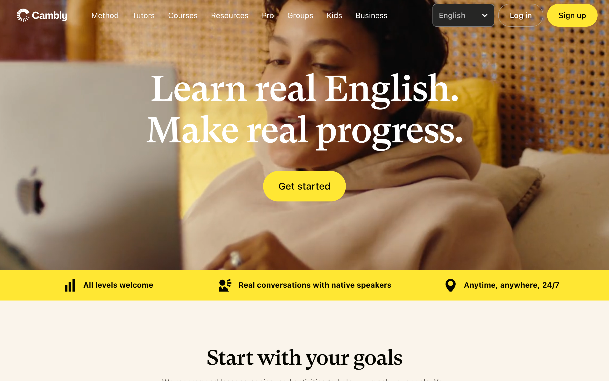

# cambly DESIGN.md

> Auto-generated design system — reverse-engineered via static analysis by skillui.
> Frameworks: None detected
> Colors: 20 · Fonts: 2 · Components: 6
> Icon library: not detected · State: not detected
> Primary theme: dark · Dark mode toggle: no · Motion: subtle

## Visual Reference

**Match this design exactly** — study colors, fonts, spacing, and component shapes before writing any UI code.



---

## 1. Visual Theme & Atmosphere

This is a **dark-themed** interface with a neutral tone. Depth is expressed through layered shadows and subtle surface color variation. Typography pairs **GT Super** for display/headings with **Garnett** for body text, creating clear visual hierarchy through type contrast. Spacing follows a **4px base grid** (compact density), with scale: 2, 4, 6, 8, 10, 12, 16, 20px. Motion is subtle — smooth transitions (150-300ms) ease state changes without drawing attention.

---

## 2. Color Palette & Roles

| Token | Hex | Role | Use |
|---|---|---|---|
| color-cambio-transparent-full | `#000000` | background | Page background, darkest surface |
| surface | `#191919` | surface | Card and panel backgrounds |
| color-base-white | `#ffffff` | text-primary | Headings and body text |
| color-base-gray-60 | `#5e5952` | text-muted | Captions, placeholders, secondary info |
| color-base-gray-800 | `#363432` | border | Dividers, card borders, outlines |
| color-base-destructive-200 | `#ff8071` | danger | Error states, destructive actions |
| color-base-success-200 | `#84ce64` | success | Success states, positive indicators |
| color-base-yellow-700 | `#ffe733` | warning | Warning states, caution indicators |
| info | `#0000ee` | info | Informational highlights |
| unknown | `#838383` | unknown | Palette color |
| color-base-gray-200 | `#e4dbd3` | unknown | Palette color |
| unknown | `#eff6fa` | unknown | Palette color |
| unknown | `#236482` | unknown | Palette color |
| color-base-gray-10 | `#beb4ab` | unknown | Palette color |
| color-base-gray-100 | `#faf4eb` | unknown | Palette color |
| unknown | `#27455c` | unknown | Palette color |
| unknown | `#656565` | unknown | Palette color |
| color-base-gray-900 | `#262625` | unknown | Palette color |
| unknown | `#cbcbcb` | unknown | Palette color |
| color-base-destructive-700 | `#c93f32` | unknown | Palette color |

### CSS Variable Tokens

```css
--color-base-destructive-100: #ffdeda;
--color-base-destructive-200: #ff8071;
--color-base-destructive-300: #ff8071;
--color-base-destructive-700: #c93f32;
--color-base-destructive-800: #6d0002;
--color-base-destructive-900: #6d0002;
--color-base-primary-100: #faf4eb;
--color-base-primary-200: #e4dbd3;
--color-base-primary-300: #beb4ab;
--color-base-primary-700: #5e5952;
--color-base-primary-800: #363432;
--color-base-primary-900: #262625;
--color-cambio-destructive-100: #ffdeda;
--color-cambio-destructive-300: #ff8071;
--color-cambio-destructive-370: rgba(255,128,113,0.7);
--color-cambio-destructive-700: #c93f32;
--color-cambio-destructive-770: rgba(201,63,50,0.7);
--color-cambio-destructive-900: #6d0002;
--color-base-destructive-100: #ffdeda;
--color-base-destructive-200: #ff8071;
```


---

## 3. Typography Rules

**Font Stack:**
- **Garnett** — Heading 1, Heading 2, Heading 3
- **GT Super** — Body, Caption

**Font Sources:**

```css
@font-face {
  font-family: "GT Super";
  src: url("fonts/GTSuper-700.woff2") format("woff2");
  font-weight: 700;
}
@font-face {
  font-family: "Garnett";
  src: url("fonts/Garnett-Regular.woff") format("woff");
  font-weight: 400;
}
```

| Role | Font | Size | Weight |
|---|---|---|---|
| Heading 1 | Garnett | 119px | 700 |
| Heading 2 | Garnett | 83px | 700 |
| Heading 3 | Garnett | 76px | 700 |
| Body | GT Super | 16px | 400 |
| Caption | GT Super | 14px | 400 |

**Typographic Rules:**
- Limit to 2 font families max per screen
- Use **Garnett** for body/UI text, **GT Super** for display/headings
- Maintain consistent hierarchy: no more than 3-4 font sizes per screen
- Headings use bold (600-700), body uses regular (400)
- Line height: 1.5 for body text, 1.2 for headings
- Use color and opacity for secondary hierarchy, not additional font sizes


---

## 4. Component Stylings

### Layout (1)

**Footer** — `html`

### Navigation (1)

**Navigation** — `html`

### Data Input (2)

**Button** — `html`

**Input** — `html`
- State: :focus, :placeholder

### Media (2)

**Image** — `html`

**Icon** — `html`


---

## 5. Layout Principles

- **Base spacing unit:** 4px
- **Spacing scale:** 2, 4, 6, 8, 10, 12, 16, 20, 24, 28, 30, 32
- **Border radius:** 1px, 2px, 2.5px, 3px, 4px, 6px, 8px, 12px, 16px, 17px, 20px, 21.27px, 24px, 34px, 50px, 52px, 100px, 100%, 999px
- **Max content width:** 960px

**Spacing as Meaning:**
| Spacing | Use |
|---|---|
| 4-8px | Tight: related items within a group |
| 12-16px | Medium: between groups |
| 24-32px | Wide: between sections |
| 48px+ | Vast: major section breaks |


---

## 6. Depth & Elevation

### Flat — subtle depth hints

- `0 0 0 1px var(--color-cambio-black) inset`
- `0 0 0 1px var(--color-base-white) inset`
- `0 0 0 1px var(--color-cambio-success-770) inset`

### Raised — cards, buttons, interactive elements

- `var(--elevation-400)`
- `0 0 0 2px #fff,0 0 0 4px #000`
- `0 0 0 4px #000`

### Floating — dropdowns, popovers, modals

- `0 4px 8px 0 rgba(0,0,0,.2),0 6px 20px 0 rgba(0,0,0,.19)`
- `0 6px 10px rgba(0,0,0,.1)`
- `rgba(0, 0, 0, 0.2) 0px 0px 18px 0px`

### Overlay — full-screen overlays, top-level dialogs

- `0 16px 32px 0 rgba(0,0,0,.25)`

### Z-Index Scale

`0, 1, 2, 10`


---

## 7. Animation & Motion

This project uses **subtle motion**. Transitions smooth state changes without demanding attention.

### CSS Animations

- `@keyframes _syntaxButtonLoadingRotate_v2jgj_1`
- `@keyframes AudioInputIconButton_camblyPulse__F3H_0`
- `@keyframes LoadingSpinner_camblySpinAnimation__534KI`
- `@keyframes FilterChip_camblyFilterChipLoading__4mouG`

### Motion Guidelines

- Duration: 150-300ms for micro-interactions, 300-500ms for page transitions
- Easing: `ease-out` for enters, `ease-in` for exits
- Always respect `prefers-reduced-motion`


---

## 8. Do's and Don'ts

### Do's

- Use `#000000` as the primary page background
- Pair **Garnett** (body) with **GT Super** (display) — these are the only allowed fonts
- Follow the **4px** spacing grid for all margins, padding, and gaps
- Use the defined shadow tokens for elevation — see Section 6
- Use border-radius from the scale: 1px, 2px, 2.5px, 3px, 4px
- Reuse existing components from Section 4 before creating new ones

### Don'ts

- Don't introduce colors outside this palette — extend the design tokens first
- Don't introduce additional font families beyond Garnett and GT Super
- Don't use arbitrary spacing values — stick to multiples of 4px
- Don't create custom box-shadow values outside the system tokens
- Don't use arbitrary border-radius values — pick from the defined scale
- Don't duplicate component patterns — check Section 4 first
- Don't use backdrop-blur or blur effects

### Anti-Patterns (detected from codebase)

- No blur or backdrop-blur effects
- No zebra striping on tables/lists


---

## 9. Responsive Behavior

| Name | Value | Source |
|---|---|---|
| xs | 480px | css |
| sm | 481px | css |
| lg | 960px | css |
| xl | 1120px | css |

**Approach:** Use `@media (min-width: ...)` queries matching the breakpoints above.


---

## 10. Agent Prompt Guide

Use these as starting points when building new UI:

### Build a Card

```
Background: #191919
Border: 1px solid #363432
Radius: 17px
Padding: 16px
Font: Garnett
Use shadow tokens from Section 6.
```

### Build a Button

```
Primary: bg var(--accent), text white
Ghost: bg transparent, border #363432
Padding: 8px 16px
Radius: 17px
Hover: opacity 0.9 or lighter shade
Focus: ring with var(--accent)
```

### Build a Page Layout

```
Background: #000000
Max-width: 960px, centered
Grid: 4px base
Responsive: mobile-first, breakpoints from Section 9
```

### Build a Stats Card

```
Surface: #191919
Label: #5e5952 (muted, 12px, uppercase)
Value: #ffffff (primary, 24-32px, bold)
Status: use success/warning/danger from Section 2
```

### Build a Form

```
Input bg: #000000
Input border: 1px solid #363432
Focus: border-color var(--accent)
Label: #5e5952 12px
Spacing: 16px between fields
Radius: 17px
```

### General Component

```
1. Read DESIGN.md Sections 2-6 for tokens
2. Colors: only from palette
3. Font: Garnett, type scale from Section 3
4. Spacing: 4px grid
5. Components: match patterns from Section 4
6. Elevation: shadow tokens
```
