# cambly — Visual Guide

> Master visual reference. Study every screenshot carefully before implementing any UI.
> Match colors, layout, typography, spacing, and motion states exactly.

## Scroll Journey

The page has cinematic scroll animations. Each screenshot below shows the exact visual state at that scroll depth.
**Replicate these transitions precisely** — the design changes dramatically as you scroll.

### Hero — Above the fold

*Scroll position: 0px of 9598px total*

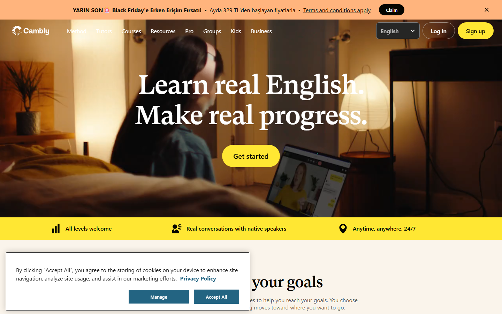

### 17% scroll depth

*Scroll position: 1479px of 9598px total*

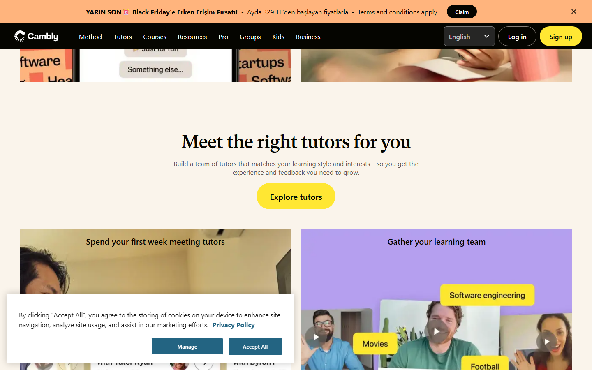

### 33% scroll depth

*Scroll position: 2870px of 9598px total*

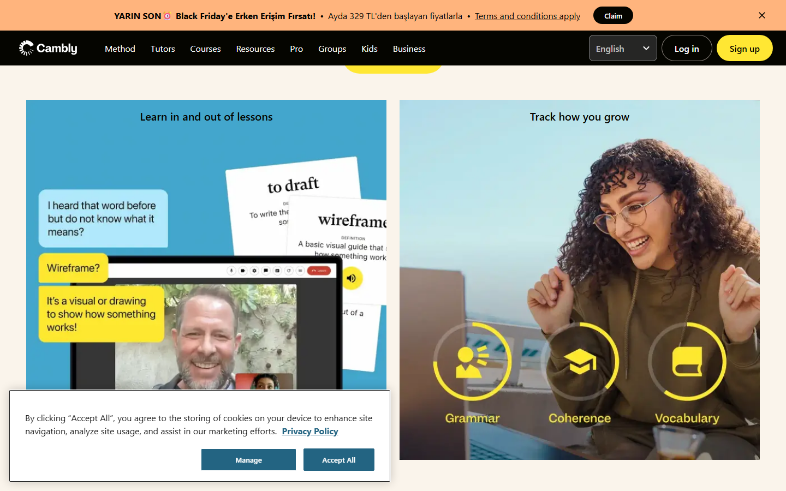

### 50% scroll depth

*Scroll position: 4349px of 9598px total*

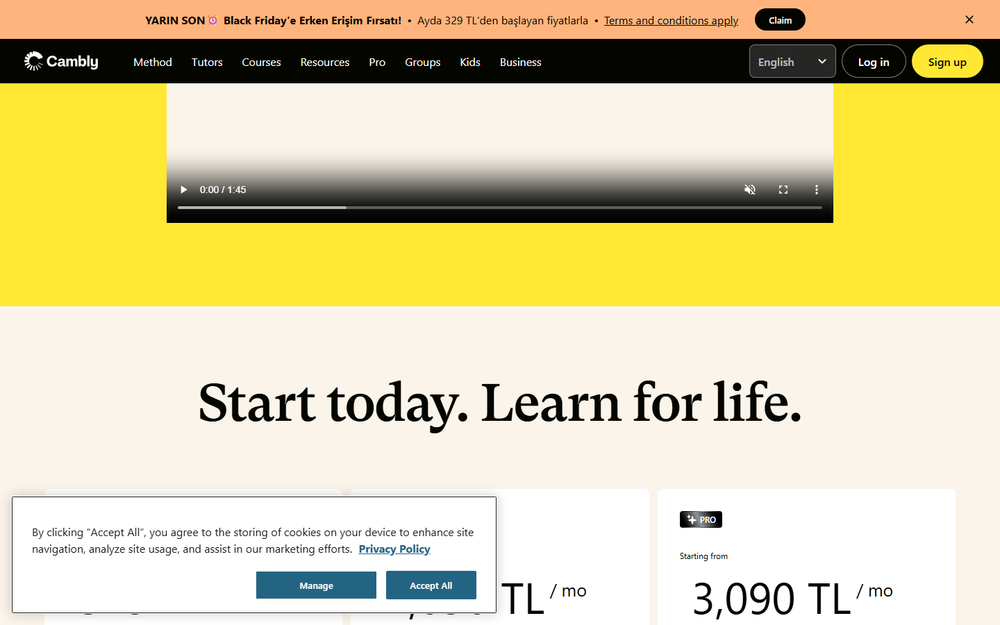

### 67% scroll depth

*Scroll position: 5828px of 9598px total*

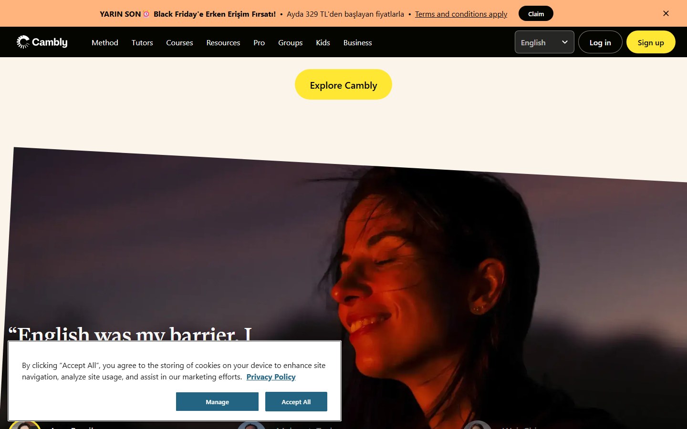

### 83% scroll depth

*Scroll position: 7219px of 9598px total*

### Footer — End of page

*Scroll position: 8698px of 9598px total*

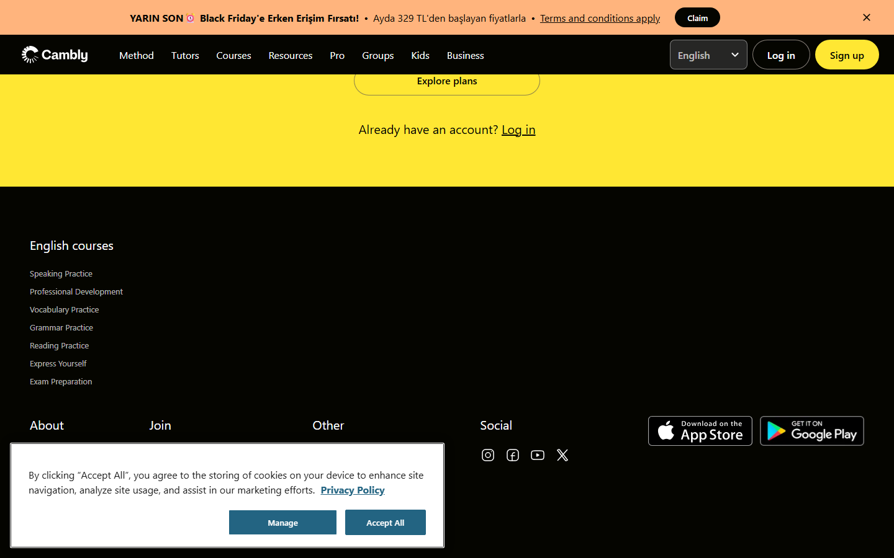

## Video Backgrounds

These videos play as background elements. Use first-frame as poster image while video loads.

### Video 1 (background)

*Source: `https://camblycdnimages.camblycdn.com/brandvideo/480x500-Video_02_v02_241024.mp4...`*

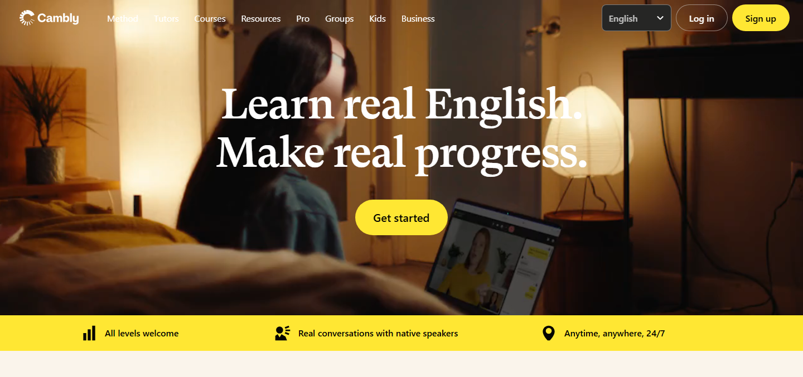

## Full Page Screenshots

### English Tutors Online - Cambly

*URL: `https://www.cambly.com/english`*

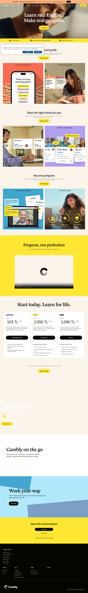

### Cambly promotion terms and conditions - Cambly

*URL: `https://www.cambly.com/english/promo-terms-and-conditions/6abba60f939fc257bea04ad9`*

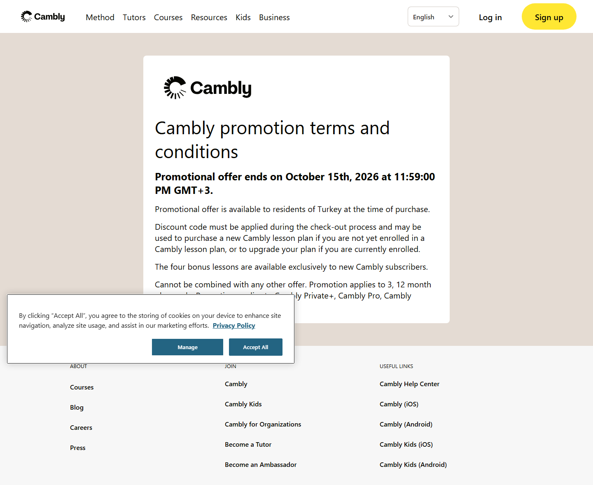

### Conversation-Based English Learning - Cambly

*URL: `https://www.cambly.com/english/method`*

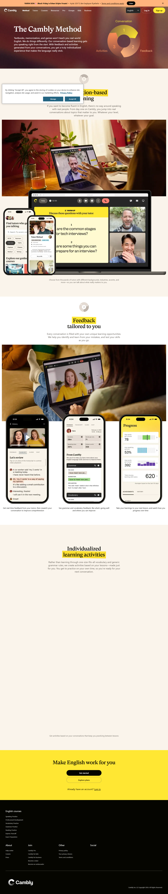

### Online English Tutors: Book a Native Speaker | Cambly

*URL: `https://www.cambly.com/english/tutors/all`*

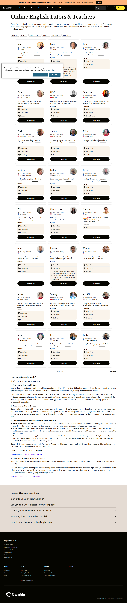

### Free English Courses - Learn with Native Speakers | Cambly

*URL: `https://www.cambly.com/english/courses`*

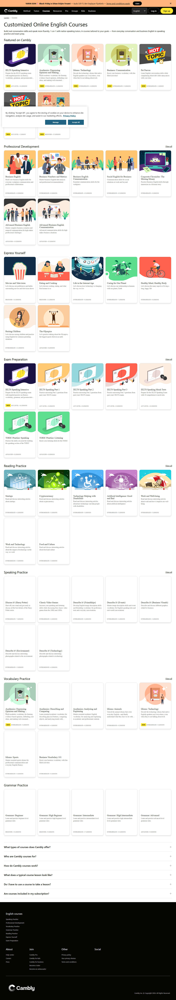

## Section Screenshots

Clipped sections showing individual components in context.

### Section 2 — `[class*="hero"]`

*1440×679px*

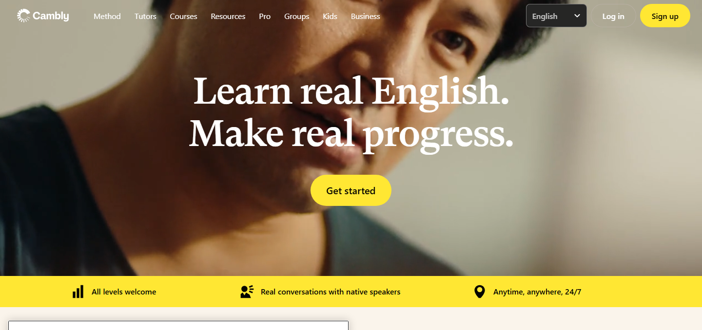

### Section 1 — `section`

*1376×869px*

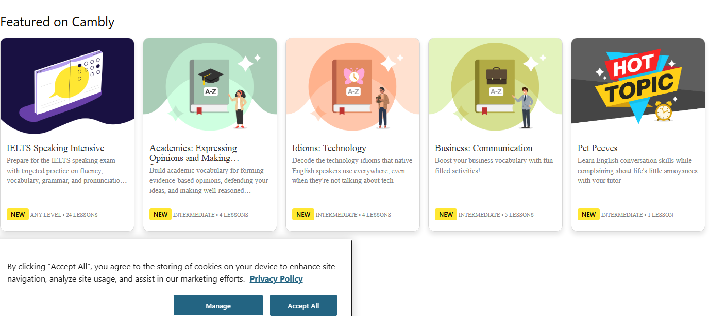

